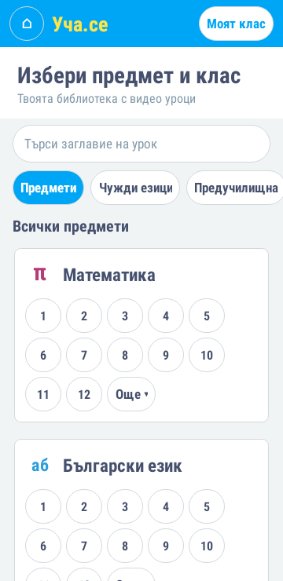
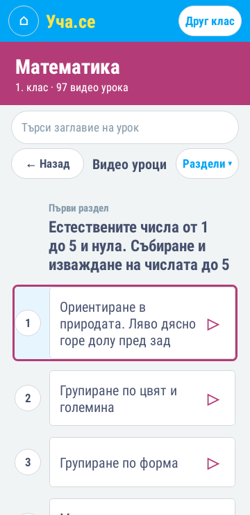
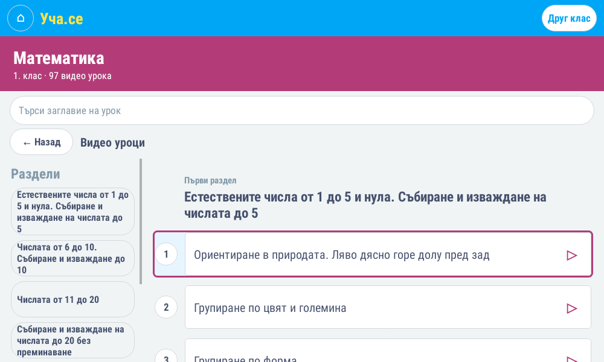

# Подредба по образец на Уча.се

Източници за структурата: [начална страница](https://ucha.se/), [каталог](https://ucha.se/videos/), [Математика — 1. клас](https://ucha.se/videos/matematika/1-klas/). Проверени на 12 ноември 2026 г.

Началният екран използва отделни предмети с иконки и кръгли бутони за наличните класове. Чуждите езици са разделени по език и ниво; ИТ предметите са самостоятелни. Предучилищната подготовка запазва 2., 3. и 4. група от торента.

Екранът за курс показва номерирани видео уроци по раздели. На широк екран разделите са вляво; на телефон се избират от бутон „Раздели“. Изборът превърта същия списък с уроци.

Единственият източник за наличието на видео е `lessons.torrent`. Няма празни позиции за уроци, които съществуват само на сайта, нито бутони за неналични тестове, учебници или преговори. Не се използват регистрации и услуги на оригиналния сайт.

За разделите са проверени 151 публични страници на курсове. Точно и еднозначно съвпадение на заглавието в съответния курс е намерено за 11 890 от 12 805 видео файла. Съпоставянето е записано в `app/src/main/assets/site-outline.tsv`, заедно с адреса на страницата. Останалите файлове се пазят в оригиналния си ред без измислени раздели. Например всичките 97 файла по математика за 1. клас са съпоставени със седемте раздела на страницата.

При нормално компилиране и използване на приложението не се изтегля каталог от сайта. Незадължително обновяване на съпоставянето:

```sh
python3 -m venv work/site-tools
work/site-tools/bin/pip install -r tools/requirements.txt
work/site-tools/bin/python tools/build_site_outline.py
```

Скриптът чете само публични HTML страници и метаданните на приложения торент. Не изтегля видео, не отваря профили и не добавя файлове, които липсват в торента. След обновяване се изпълняват тестовете преди компилиране.

## Преглед на Android оформлението

Екраните по-долу са рендерирани от действителния Android код с приложения торент и каталога на разделите чрез Robolectric (Android 9). Те не са изображения от физически устройства. При създаването им не е изтегляно видео.

| Предмети на телефон | Уроци на телефон |
| --- | --- |
|  |  |


